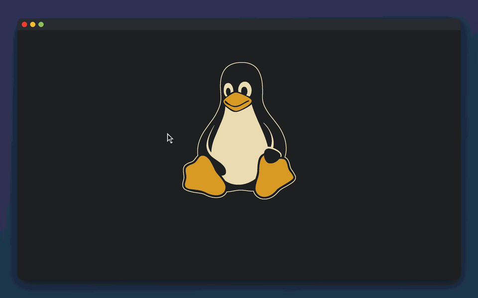

<div align="center">

# AI Quota for KDE Plasma

**See your Claude Code, OpenAI Codex, OpenCode Go, Command Code and Replit usage limits right in your KDE Plasma 6 panel.**




</div>

Stop opening five dashboards to check whether you're about to hit a rate limit. **AI Quota** is a tiny
Plasma widget (plasmoid) that shows the 5-hour, weekly and monthly quotas of every AI coding assistant
you pay for, colour-coded, with reset times, next to your clock.

## Features

- **One glance, all your AI subscriptions** — Claude Code (Pro / Max), OpenAI Codex (ChatGPT Plus / Pro),
  OpenCode Go, Command Code and Replit credits.
- **Real numbers, not guesses** — reads the same endpoints the official CLIs use (`claude /usage`,
  `codex /status`, `cmd /usage`, the opencode.ai console, replit.com billing).
- **5-hour, weekly, monthly and per-model windows** (e.g. Claude's weekly Opus/Sonnet limits) with reset times.
- **Colour-coded bars** — green < 60 %, yellow < 85 %, red ≥ 85 %.
- **Zero setup for most services** — uses the credentials your CLIs already store; nothing to paste.
- **Privacy first** — tokens never leave the collector, are never logged or cached, and are only sent to the
  service they belong to. Read-only: it can't spend credits or change anything.
- **Gentle on APIs** — results are cached for 5 minutes, one process at a time, automatic back-off on HTTP 429.
- **English and Turkish UI** (follows your system locale). PRs for more languages welcome.

## Supported services

| Service | What you see | Where credentials come from |
|---|---|---|
| **Claude Code** | 5-hour, weekly, per-model weekly, extra usage | `~/.claude/.credentials.json` (`claude` login) |
| **OpenAI Codex** | 5-hour and weekly windows | `~/.codex/auth.json` (`codex` ChatGPT login); falls back to local session logs |
| **OpenCode Go** | 5-hour, weekly, monthly ($ used / limit) | `~/.local/share/opencode/auth.json` (`opencode auth login`) + org id |
| **Command Code** | 5-hour, weekly, monthly credit | `~/.commandcode/auth.json` (`cmd login`) |
| **Replit** | remaining credits | your browser's replit.com session (Chromium-based browsers) |

Services you don't use are simply hidden.

## Install

Requirements: KDE Plasma 6, Python 3.10+. Replit additionally needs `python-cryptography`
(`sudo pacman -S python-cryptography` / `sudo apt install python3-cryptography`).

```bash
git clone https://github.com/the-arma-of-owl/plasma-ai-quota.git
cd plasma-ai-quota
./install.sh
```

Then right-click your panel → **Add Widgets…** → search **AI Quota** → drag it onto the panel.

Update: `git pull && ./install.sh`. Uninstall: `kpackagetool6 -t Plasma/Applet -r com.github.the-arma-of-owl.aiquota`.

## Configuration (optional)

Everything works without a config file. To tweak things create `~/.config/plasma-ai-quota/config.json`
(see [`config.example.json`](config.example.json)):

```json
{
  "cache_seconds": 300,
  "opencode": { "org_id": "org_..." },
  "replit": { "browser": "auto" },
  "codex": { "enabled": false }
}
```

### OpenCode Go

OpenCode's quota endpoint needs an API key **with the `Billing: Read` permission** (a key with only
`Usage: Read` gets 403):

1. opencode.ai → your workspace → **API Keys** → *Create* with `Models: Request`, `Billing: Read`.
2. `opencode auth login` and paste the key (or write `~/.local/share/opencode/auth.json` yourself).
3. Put your workspace id (`org_…`, visible in the console URL / requests) into `opencode.org_id`.

### Replit

Replit has no public usage API, so the collector reads the `connect.sid` cookie of a browser where you're
logged in to replit.com (Helium, Chrome, Chromium, Brave, Vivaldi; `"browser": "auto"` tries them in order)
and calls replit.com's own read-only billing query. The cookie is decrypted in memory on every run and never
stored. If you'd rather not, set `"replit": {"enabled": false}`.

## CLI

The collector is a standalone script, handy for status bars, scripts or debugging:

```bash
python3 ~/.local/share/plasma/plasmoids/com.github.the-arma-of-owl.aiquota/contents/code/ai_quota.py --json
```

`--force` refreshes now (at most once a minute), `--cached` only prints the cache.

## FAQ

**Is this allowed?** It only reads your own account's usage through the same endpoints the official tools call
for you, at most every 5 minutes. It never refreshes, copies or exports tokens.

**A service shows "API changed"** — vendors change private endpoints from time to time. Open an issue and it'll
be fixed quickly.

**Waybar / Polybar / GNOME?** The collector prints plain JSON, so wiring it into other bars is easy. PRs welcome.

## Contributing

Issues and PRs are welcome, especially new services (Cursor, Gemini CLI, GitHub Copilot, Windsurf…) and
translations. If this saved you a few dashboard visits, a ⭐ helps others find it.

## License

[MIT](LICENSE) © Efe Çam

<sub>Not affiliated with Anthropic, OpenAI, OpenCode, Command Code, Replit or KDE. All trademarks belong to their owners; logos from [Simple Icons](https://simpleicons.org) (CC0).</sub>
